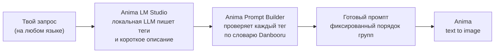
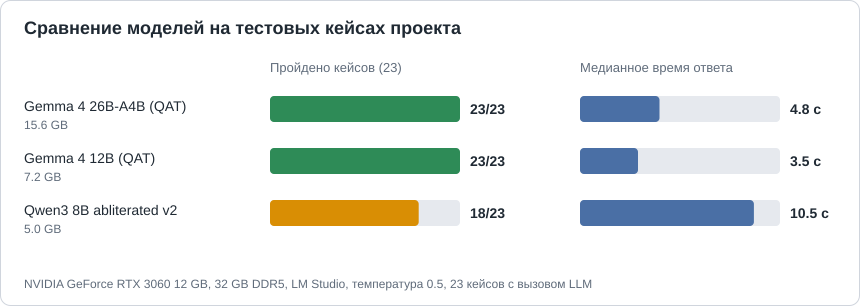
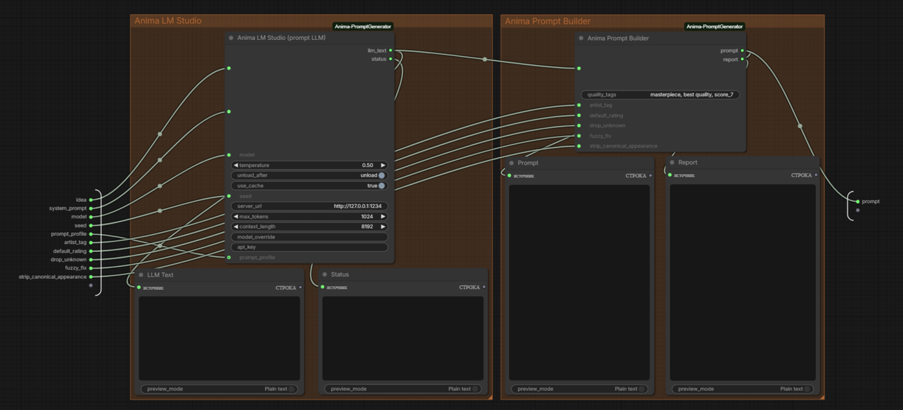

# Anima Prompt Generator для ComfyUI

[English version](README.md)

Пишешь короткий запрос на любом языке. Локальная нейросеть превращает его в теги Danbooru и короткое описание, а билдер проверяет каждый тег по словарю и собирает промпт для модели **Anima** в фиксированном порядке.

Теги, которые пишет нейросеть, часто почти правильные: `misato katsuragi` вместо `katsuragi misato`, `side view` вместо `from side`, цвет волос, которого у персонажа нет. Билдер исправляет такое автоматически и сообщает, что именно он поменял.

## Как это работает



1. **Anima LM Studio (prompt LLM)** отправляет запрос и системный промпт на локальный сервер LM Studio и получает строки вида `character: ...`, `action: ...`, `description: ...`.
2. **Anima Prompt Builder** разбирает ответ, исправляет или удаляет теги по словарю, ставит группы в фиксированном порядке с пустой строкой между ними и добавляет описание в конце.
3. Промпт идёт в твой workflow с Anima.

## Пример

Запрос:

```
Misato Katsuragi пьёт пиво на балконе
```

Настоящий ответ `gemma-4-26b` (записан в тестах):

```
rating: safe
count: 1girl
character: misato katsuragi
series: evangelion
appearance: long hair, purple hair
emotion: smile, relaxed
action: drinking, holding bottle, sitting, looking at viewer
location: balcony
environment: apartment, city, night, sky
angle: upper body
lighting: moonlight, city lights
description: Misato Katsuragi relaxes on her balcony at night, enjoying a bottle of beer. The city lights glow in the background under the moonlight.
```

Промпт после билдера:

```
masterpiece, best quality, score_7, safe,

1girl,

katsuragi misato,

neon genesis evangelion,

long hair,

smile, relaxing,

drinking, holding bottle, sitting, looking at viewer,

balcony,

apartment, city, night, sky,

upper body,

moonlight, city lights.

Misato Katsuragi relaxes on her balcony at night, enjoying a bottle of beer. The city lights glow in the background under the moonlight.
```

Что поменял билдер (это выход `report` ноды, сообщения на английском):

```
alias: evangelion -> neon genesis evangelion
name order fixed: misato katsuragi -> katsuragi misato
hair/eye color of the named character removed: purple hair
alias: relaxed -> relaxing
```

## Что умеет

- Проверяет каждый тег по словарю из примерно 33 800 тегов Danbooru и около 7 500 алиасов.
- Находит персонажа в виде `имя (серия)` с учётом серии и популярности тега и исправляет порядок имени (`misato katsuragi` -> `katsuragi misato`).
- Исправляет теги с дефисом (`close up` -> `close-up`) и почти совпадающие теги, которые отличаются только типичным окончанием (`indoor` -> `indoors`).
- Удаляет теги, которых нет в словаре (кроме `character` и `series`, там редкие имена остаются).
- Переносит теги взгляда (`looking at viewer`, `looking away` и другие) в группу действия.
- Удаляет цвета волос и глаз, которые нейросеть написала заданному персонажу, потому что модель и так его знает (можно отключить).
- Выбрасывает теги качества, года и художника, которые написала нейросеть: качество и художника задаёшь ты.
- Держит фиксированный порядок групп: качество и рейтинг, количество, персонаж, серия, тег художника, внешность, эмоции, состояние, действие, место, окружение, ракурс, освещение, описание.
- Кэширует ответы нейросети: тот же запрос с теми же настройками не запускает модель заново.
- Загружает модель по требованию и может выгружать её после ответа, чтобы видеопамять была свободна для генерации картинки.
- Три профиля промпта: `sfw`, `nsfw` и `custom`.

## Требования и железо

- ComfyUI с файлами модели Anima (список есть в примере workflow).
- [LM Studio](https://lmstudio.ai/) с включённым локальным сервером. Проверен только LM Studio. Серверы с `/v1/models` и `/v1/chat/completions` (Ollama, llama.cpp server и похожие) могут заработать, если вписать имя модели в `model_override`, но это не проверялось: список моделей их модели не покажет, а в статусе может появиться безобидная пометка, что выгрузить модель не удалось.
- Дополнительные пакеты Python не нужны.

Проверено на **NVIDIA GeForce RTX 3060 12 ГБ, 32 ГБ DDR5**, LM Studio, режим мышления выключен, температура 0,5. Другое железо не проверялось.



| Модель | Размер файла | Пройдено кейсов | Медианный ответ | Средний ответ |
|---|---|---|---|---|
| `google/gemma-4-26b-a4b-qat` | 15,6 ГБ | 23 из 23 | 4,8 с | 5,5 с |
| `google/gemma-4-12b-qat` | 7,2 ГБ | 23 из 23 | 3,5 с | 4,6 с |
| `huihui-qwen3-8b-abliterated-v2` | 5,0 ГБ | 18 из 23 | 10,5 с | 12,2 с |

Как читать таблицу:

- В тестах 35 кейсов: 23 вызывают нейросеть, остальные 12 проверяют билдер на готовых ответах. В таблице учтены 23 кейса с вызовом нейросети. Исходные цифры лежат в `docs/models_benchmark.json`.
- Первый запрос каждого прогона включает загрузку модели, поэтому медиана честнее среднего.
- Тесты проверяют **структуру** результата: формат, рейтинг, обязательные и запрещённые теги, отсутствие дублей, отсутствие служебного текста, не слишком много удалённых тегов, законченное описание. Они **не** измеряют, насколько хорошо модель знает персонажей. Две модели с одинаковым счётом всё равно могут отличаться.
- Qwen не справился с одним персонажем, с одним пустым ответом, с одним длинным запросом, где потерял детали, и с обоими откровенными запросами в профиле `sfw`.
- Gemma 26B-A4B это модель типа mixture-of-experts: на карте с 12 ГБ часть её работает из оперативной памяти, и всё равно отвечает примерно за 5 с. Gemma 12B целиком помещается в видеопамять и чуть быстрее.

## Установка

1. Положи папку `Anima-Prompt-Generator` в `ComfyUI/custom_nodes/` (скачай ZIP или выполни там `git clone https://github.com/GUntilB/Anima-Prompt-Generator`) и перезапусти ComfyUI. Установка из ComfyUI Registry появится с первым релизом.
2. Установи LM Studio, скачай модель и запусти локальный сервер (вкладка Developer). Адрес по умолчанию `http://127.0.0.1:1234`.
3. Положи файлы модели Anima в папки моделей ComfyUI (в примере workflow они перечислены).

## Быстрый старт

1. Открой пример `Anima_Prompt_Generator_basic` в браузере шаблонов (раздел этого набора нод) или загрузи файл из `example_workflows/`.
2. В подграфе **Anima Prompt Generator** выбери свою модель в списке `model`. Значок в углу подграфа открывает его содержимое: там видны ответ нейросети, отчёт и готовый промпт.
3. Напиши запрос и нажми Run.



Так выглядит подграф, когда его открываешь: нода LLM и билдер, а также окна просмотра ответа нейросети, статуса, готового промпта и отчёта.

Поле `artist_tag` заполняй, если используешь LoRA или тег художника, который должен быть в каждом промпте. Иначе оставь его пустым.

## Ноды

### Anima LM Studio (prompt LLM)

Выходы: `llm_text` (ответ нейросети) и `status` (попадание в кэш, время генерации, загрузка и выгрузка модели).

| Параметр | Что делает |
|---|---|
| `idea` | Что должно быть на картинке, на любом языке. |
| `system_prompt` | Твои собственные инструкции для нейросети. Используется только при `prompt_profile` = `custom`. |
| `model` | Модель на сервере. Список читается при загрузке ноды, `R` обновляет его. |
| `temperature` | Случайность ответа. По умолчанию 0,5. |
| `unload_after` | Выгрузить модель после ответа и освободить видеопамять. |
| `use_cache` | Использовать прошлый ответ, если запрос и все настройки не менялись. |
| `seed` | Сид, который уходит на сервер. Входит в ключ кэша. |
| `server_url` | Адрес сервера LM Studio. |
| `max_tokens` | Предел длины ответа. Увеличь, если в статусе написано, что ответ обрезан. |
| `context_length` | Размер контекста, когда нода сама загружает модель. |
| `model_override` | Имя модели, введённое вручную. Используется вместо списка. |
| `api_key` | Только если сервер требует ключ. |
| `prompt_profile` | `sfw`, `nsfw` или `custom`. |

### Anima Prompt Builder

Выходы: `prompt` (готовый промпт) и `report` (что было изменено).

| Параметр | Что делает |
|---|---|
| `text` | Ответ нейросети. Сюда подключается `llm_text`. |
| `quality_tags` | Теги качества в самом начале. По умолчанию `masterpiece, best quality, score_7`. |
| `artist_tag` | Тег художника или триггер LoRA, ставится после серии. По умолчанию пустой. |
| `default_rating` | Рейтинг, если нейросеть его не дала: `safe`, `sensitive`, `nsfw`, `explicit` или `none`. |
| `drop_unknown` | Удалять теги, которых нет в словаре. |
| `fuzzy_fix` | Исправлять почти совпадающие теги, отличающиеся только типичным окончанием. |
| `strip_canonical_appearance` | Удалять цвета волос и глаз, написанные заданному персонажу. |

## Профили промпта

Системный промпт, который объясняет нейросети, как отвечать, лежит в текстовых файлах:

- `prompts/sfw.txt` (по умолчанию): только рейтинги `safe` и `sensitive`; если просят откровенную сцену, описывается одетая версия без сексуального содержания.
- `prompts/nsfw.txt`: все четыре рейтинга.
- `custom`: берётся текст поля `system_prompt` ноды, файлы игнорируются. При `sfw` и `nsfw` это поле игнорируется.

Оба встроенных промпта требуют писать только совершеннолетних персонажей (18+). Файлы читаются при каждом запуске, так что правки действуют сразу, а кэш замечает новый текст.

## Языки

- Документация есть на английском (`README.md`) и на русском (`README.ru.md`).
- Если язык интерфейса ComfyUI русский, описания нод и подсказки к параметрам показываются по-русски (файлы в `locales/`). Названия параметров везде остаются английскими, чтобы совпадать с документацией.
- Выходы `status` и `report` тоже следуют языку интерфейса (язык читается из настроек ComfyUI; всё, кроме русского, даёт английский). Чтобы задать язык принудительно, перед запуском ComfyUI установи переменную окружения `ANIMA_PG_LANG` в `en` или `ru`.

## Словарь

Словарь лежит в `data/`:

- `data/auto/tags.csv` и `data/auto/aliases.csv`: сгенерированные файлы, их может перезаписывать обновление. Сейчас в них 17 541 общий тег, 673 художника, 3 347 серий, 12 067 персонажей и 214 мета-тегов.
- `data/manual/tags.csv` и `data/manual/aliases.csv`: твои собственные правки. Они читаются после сгенерированных файлов и всегда побеждают, обновления их не трогают.

Свой тег добавляется в `data/manual/tags.csv` (колонки `tag,category,post_count`; категория 0 общие, 1 художник, 3 серия, 4 персонаж, 5 мета):

```
tag,category,post_count
looking away,0,32000
```

Алиас добавляется в `data/manual/aliases.csv` (колонки `alias,tag`):

```
alias,tag
swimwear,swimsuit
```

После правки файлов перезапусти ComfyUI. Откуда взяты данные, описано в `data/SOURCES.md`. Обновление словаря с Danbooru планируется.

## Кэш

Ответы нейросети хранятся в пользовательской папке ComfyUI (`user/anima_promptgenerator/lmstudio_cache.json`), поэтому обновление набора нод их не теряет. Ключ строится из твоего запроса, текста системного промпта, модели, температуры, `max_tokens` и `seed`. Чтобы очистить кэш, удали файл.

## Тесты

```
python tests/run_tests.py                              # быстрый режим: готовые и записанные ответы, без нейросети
python tests/run_tests.py --live                       # настоящие запросы к LM Studio
python tests/run_tests.py --live --record              # сохранить ответы нейросети в tests/recorded/
python tests/run_tests.py --live --model ИМЯ --out last_run_ИМЯ.txt   # сравнить модели
```

Лог с готовыми промптами пишется в `tests/last_run.txt`. При сравнении моделей не используй `--record`: он перезаписывает записанные ответы.

## Частые проблемы

| Сообщение | Что делать |
|---|---|
| `cannot reach the LLM server (...)` | Запусти сервер LM Studio и проверь `server_url`. |
| `(LLM server unavailable: start it and press R)` в списке моделей | Запусти сервер и нажми `R` в ComfyUI, чтобы обновить ноду. |
| `Model '...' not found on the server. Available: ...` | Выбери модель из списка или впиши точное имя в `model_override`. |
| `answer cut off by max_tokens, raise the limit` | Увеличь `max_tokens`. |
| `prompt_profile is 'custom' but system_prompt is empty.` | Заполни `system_prompt` или выбери `sfw` / `nsfw`. |
| Тег пропал из промпта | Посмотри выход `report`; если тег настоящий, добавь его в `data/manual/tags.csv`. |


## Лицензия и благодарности

Код: GNU General Public License v3.0 или новее, см. `LICENSE`. Copyright (c) 2026 GUntilB.

- Модель Anima и её файлы: circlestone-labs (Hugging Face).
- Названия тегов, категории и счётчики постов взяты с Danbooru; проект не связан с Danbooru.
- Словарь дополнен датасетом `newtextdoc1111/danbooru-tag-csv` (MIT), см. `data/SOURCES.md`.
- LM Studio и ComfyUI принадлежат своим авторам.

## Идеи на потом

Полная поддержка OpenAI-совместимых серверов (список моделей с `server_url`, без попытки выгрузки там, где её нет, повтор запроса для более строгих серверов) и обновление словаря с Danbooru.
