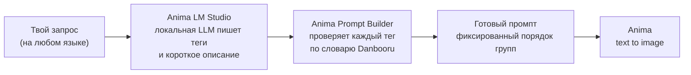
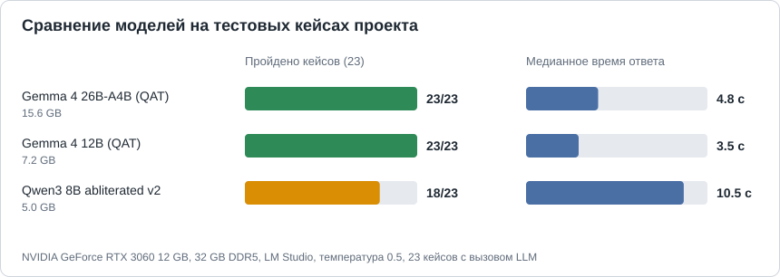
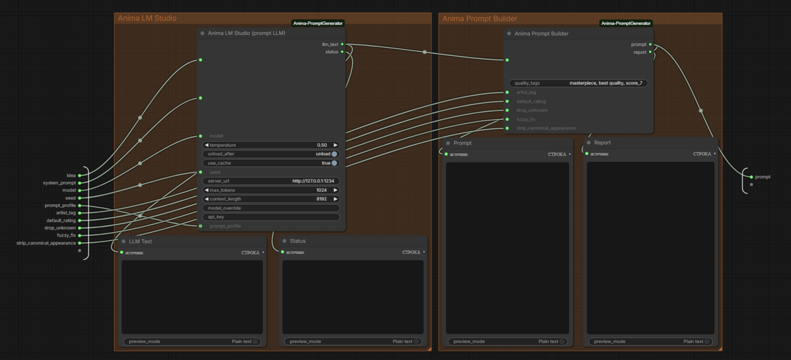

# Anima Prompt Generator для ComfyUI

[English version](README.md)

Пишешь короткий запрос на любом языке. Локальная нейросеть превращает его в теги Danbooru и короткое описание, а билдер проверяет каждый тег по словарю и собирает промпт для модели **Anima** в фиксированном порядке.

Теги, которые пишет нейросеть, часто почти правильные: `misato katsuragi` вместо `katsuragi misato`, `side view` вместо `from side`, цвет волос, которого у персонажа нет. Билдер исправляет такое автоматически и сообщает, что именно он поменял.

## Как это работает



1. **Anima LM Studio (prompt LLM)** отправляет запрос и системный промпт на локальный сервер LM Studio и получает строки вида `character: ...`, `action: ...`, `description: ...`.
2. **Anima Prompt Builder** разбирает ответ, исправляет или удаляет теги по словарю, ставит группы в фиксированном порядке с пустой строкой между ними и добавляет описание в конце.
3. Промпт идёт в твой workflow с Anima.

## Пример

Запрос:

```
Misato Katsuragi пьёт пиво на балконе
```

Настоящий ответ `gemma-4-26b` (записан в тестах):

```
rating: safe
count: 1girl
character: misato katsuragi
series: evangelion
appearance: long hair, purple hair
emotion: smile, relaxed
action: drinking, holding bottle, sitting, looking at viewer
location: balcony
environment: apartment, city, night, sky
angle: upper body
lighting: moonlight, city lights
description: Misato Katsuragi relaxes on her balcony at night, enjoying a bottle of beer. The city lights glow in the background under the moonlight.
```

Промпт после билдера:

```
masterpiece, best quality, score_7, safe,

1girl,

katsuragi misato,

neon genesis evangelion,

long hair,

smile, relaxing,

drinking, holding bottle, sitting, looking at viewer,

balcony,

apartment, city, night, sky,

upper body,

moonlight, city lights.

Misato Katsuragi relaxes on her balcony at night, enjoying a bottle of beer. The city lights glow in the background under the moonlight.
```

Что поменял билдер (это выход `report` ноды, сообщения на английском):

```
alias: evangelion -> neon genesis evangelion
name order fixed: misato katsuragi -> katsuragi misato
hair/eye color of the named character removed: purple hair
alias: relaxed -> relaxing
```

## Что умеет

- Проверяет каждый тег по словарю из примерно 80 000 тегов Danbooru и около 17 000 алиасов.
- Находит персонажа в виде `имя (серия)` с учётом серии и популярности тега и исправляет порядок имени (`misato katsuragi` -> `katsuragi misato`).
- Исправляет теги с дефисом (`close up` -> `close-up`) и почти совпадающие теги, которые отличаются только типичным окончанием (`indoor` -> `indoors`).
- Удаляет теги, которых нет в словаре (кроме `character` и `series`, там редкие имена остаются).
- Переносит теги взгляда (`looking at viewer`, `looking away` и другие) в группу действия.
- Удаляет цвета волос и глаз, которые нейросеть написала заданному персонажу, потому что модель и так его знает (можно отключить).
- Выбрасывает теги качества, года и художника, которые написала нейросеть: качество и художника задаёшь ты.
- Держит фиксированный порядок групп: качество и рейтинг, количество, персонаж, серия, тег художника, внешность, эмоции, состояние, действие, место, окружение, ракурс, освещение, описание.
- Кэширует ответы нейросети: тот же запрос с теми же настройками не запускает модель заново.
- Загружает модель по требованию и может выгружать её после ответа, чтобы видеопамять была свободна для генерации картинки.
- Три профиля промпта: `sfw`, `nsfw` и `custom`.

## Требования и железо

- ComfyUI с файлами модели Anima (список есть в примере workflow).
- [LM Studio](https://lmstudio.ai/) с включённым локальным сервером. Проверен только LM Studio. Серверы с `/v1/models` и `/v1/chat/completions` (Ollama, llama.cpp server и похожие) могут заработать, если вписать имя модели в `model_override`, но это не проверялось: список моделей их модели не покажет, а в статусе может появиться безобидная пометка, что выгрузить модель не удалось.
- Обновление словаря использует пакет `requests`. Обычно он уже есть в Python-окружении ComfyUI и указан в `requirements.txt`; остальным нодам он не нужен.

Проверено на **NVIDIA GeForce RTX 3060 12 ГБ, 32 ГБ DDR5**, LM Studio, режим мышления выключен, температура 0,5. Другое железо не проверялось.



| Модель | Размер файла | Пройдено кейсов | Медианный ответ | Средний ответ |
|---|---|---|---|---|
| `google/gemma-4-26b-a4b-qat` | 15,6 ГБ | 23 из 23 | 4,8 с | 5,5 с |
| `google/gemma-4-12b-qat` | 7,2 ГБ | 23 из 23 | 3,5 с | 4,6 с |
| `huihui-qwen3-8b-abliterated-v2` | 5,0 ГБ | 18 из 23 | 10,5 с | 12,2 с |

Как читать таблицу:

- В тестах 35 кейсов: 23 вызывают нейросеть, остальные 12 проверяют билдер на готовых ответах. В таблице учтены 23 кейса с вызовом нейросети. Исходные цифры лежат в `docs/models_benchmark.json`.
- Первый запрос каждого прогона включает загрузку модели, поэтому медиана честнее среднего.
- Тесты проверяют **структуру** результата: формат, рейтинг, обязательные и запрещённые теги, отсутствие дублей, отсутствие служебного текста, не слишком много удалённых тегов, законченное описание. Они **не** измеряют, насколько хорошо модель знает персонажей. Две модели с одинаковым счётом всё равно могут отличаться.
- Qwen не справился с одним персонажем, с одним пустым ответом, с одним длинным запросом, где потерял детали, и с обоими откровенными запросами в профиле `sfw`.
- Gemma 26B-A4B это модель типа mixture-of-experts: на карте с 12 ГБ часть её работает из оперативной памяти, и всё равно отвечает примерно за 5 с. Gemma 12B целиком помещается в видеопамять и чуть быстрее.

## Установка

1. Положи папку `Anima-Prompt-Generator` в `ComfyUI/custom_nodes/` (скачай ZIP или выполни там `git clone https://github.com/GUntilB/Anima-Prompt-Generator`) и перезапусти ComfyUI. Или установи из ComfyUI Registry: найди «Anima Prompt Generator» в ComfyUI Manager или выполни comfy node install anima-prompt-generator.
2. Установи LM Studio, скачай модель и запусти локальный сервер (вкладка Developer). Адрес по умолчанию `http://127.0.0.1:1234`.
3. Положи файлы модели Anima в папки моделей ComfyUI (в примере workflow они перечислены).

## Быстрый старт

1. Открой пример `Anima_Prompt_Generator_basic` в браузере шаблонов (раздел этого набора нод) или загрузи файл из `example_workflows/`.
2. В подграфе **Anima Prompt Generator** выбери свою модель в списке `model`. Значок в углу подграфа открывает его содержимое: там видны ответ нейросети, отчёт и готовый промпт.
3. Напиши запрос и нажми Run.



Так выглядит подграф, когда его открываешь: нода LLM и билдер, а также окна просмотра ответа нейросети, статуса, готового промпта и отчёта.

Поле `artist_tag` заполняй, если используешь LoRA или тег художника, который должен быть в каждом промпте. Иначе оставь его пустым.

## Ноды

### Anima LM Studio (prompt LLM)

Выходы: `llm_text` (ответ нейросети) и `status` (попадание в кэш, время генерации, загрузка и выгрузка модели).

| Параметр | Что делает |
|---|---|
| `idea` | Что должно быть на картинке, на любом языке. |
| `system_prompt` | Твои собственные инструкции для нейросети. Используется только при `prompt_profile` = `custom`. |
| `model` | Модель на сервере. Список читается при загрузке ноды, `R` обновляет его. |
| `temperature` | Случайность ответа. По умолчанию 0,5. |
| `unload_after` | Выгрузить модель после ответа и освободить видеопамять. |
| `use_cache` | Использовать прошлый ответ, если запрос и все настройки не менялись. |
| `seed` | Сид, который уходит на сервер. Входит в ключ кэша. |
| `server_url` | Адрес сервера LM Studio. |
| `max_tokens` | Предел длины ответа. Увеличь, если в статусе написано, что ответ обрезан. |
| `context_length` | Размер контекста, когда нода сама загружает модель. |
| `model_override` | Имя модели, введённое вручную. Используется вместо списка. |
| `api_key` | Только если сервер требует ключ. |
| `prompt_profile` | `sfw`, `nsfw` или `custom`. |

### Anima Prompt Builder

Выходы: `prompt` (готовый промпт) и `report` (что было изменено).

| Параметр | Что делает |
|---|---|
| `text` | Ответ нейросети. Сюда подключается `llm_text`. |
| `quality_tags` | Теги качества в самом начале. По умолчанию `masterpiece, best quality, score_7`. |
| `artist_tag` | Тег художника или триггер LoRA, ставится после серии. По умолчанию пустой. |
| `default_rating` | Рейтинг, если нейросеть его не дала: `safe`, `sensitive`, `nsfw`, `explicit` или `none`. |
| `drop_unknown` | Удалять теги, которых нет в словаре. |
| `fuzzy_fix` | Исправлять почти совпадающие теги, отличающиеся только типичным окончанием. |
| `strip_canonical_appearance` | Удалять цвета волос и глаз, написанные заданному персонажу. |

### Anima Dictionary Updater

Три кнопки, которые обновляют словарь с Danbooru: **Update tags from Danbooru** («Обновить теги»), **Update aliases from Danbooru** («Обновить алиасы») и **Update tags and aliases** («Обновить теги и алиасы»). Под ними поле статуса показывает ход и итог. У ноды нет соединений, в рабочем процессе она не запускается: поставь её на холст рядом с подграфом и нажми кнопку.

Два поля над кнопками относятся к тегам (кнопка алиасов их не использует), а выставленные значения сохраняются вместе с рабочим процессом:

- `min_posts`: минимальное число постов у тега. По умолчанию 100, это около 80 000 тегов и примерно минута. **Меньшие значения дают намного больше тегов и намного более долгое обновление.** При 1 скачивается весь список тегов Danbooru (сотни тысяч тегов и больше): обновление идёт очень долго, файлы становятся очень большими, билдер занимает больше памяти и работает медленнее. Большие значения дают меньший и более быстрый словарь.
- `include_deprecated`: по умолчанию включено. Danbooru помечает часть тегов устаревшими (например, `looking away`), хотя посты с ними ещё есть и модель может их знать, поэтому они остаются. Выключи, чтобы их не брать.

- **Теги**: все теги не меньше чем с `min_posts` постами (общие, художники, серии, персонажи, мета) записываются в `data/auto/tags.csv`. Устаревшие теги остаются, если не выключено `include_deprecated`; самые частые из них в любом случае перечислены в `data/auto/update_report.txt`.
- **Алиасы**: все активные алиасы Danbooru, чей целевой тег есть в словаре, записываются в `data/auto/aliases.csv`. Кнопка только для алиасов использует уже имеющиеся теги (сгенерированные и твои); кнопка для обоих сначала обновляет теги.
- Файлы заменяются только после того, как всё скачано и проверено. Если Danbooru отвечает неполно или странно (слишком мало тегов, нарушен порядок), файлы остаются как были. Прежняя версия сохраняется рядом как `tags.backup.csv` и `aliases.backup.csv`.
- Словарь перечитывается при изменении файла: перезапуск не нужен, следующий запуск (или `R`) уже использует новые данные. `data/manual/` не затрагивается.
- Сеть используется только при нажатии кнопки или запуске команды ниже, и обращения идут только к `danbooru.donmai.us`. Обновление пакета нод возвращает файлы той версии, которую ты ставишь; нажми кнопку ещё раз, если нужны самые свежие данные.

То же самое из консоли, Python'ом, который запускает ComfyUI (для портативной сборки Windows это `python_embeded\python.exe`), из папки пакета нод:

```
python tools/update_tags.py tags       # только теги
python tools/update_tags.py aliases    # только алиасы, проверяются по текущим тегам
python tools/update_tags.py all        # теги, затем алиасы
python tools/update_tags.py probe      # по две страницы каждого списка, ничего не пишет: быстрая проверка API Danbooru
```

Параметры: `--min-posts N` (по умолчанию 100; учти предупреждение выше), `--skip-deprecated`, `--force` (не сверять с прежними файлами), `--lang en|ru`. В Windows можно запускать через `py` вместо `python`.

## Профили промпта

Системный промпт, который объясняет нейросети, как отвечать, лежит в текстовых файлах:

- `prompts/sfw.txt` (по умолчанию): только рейтинги `safe` и `sensitive`; если просят откровенную сцену, описывается одетая версия без сексуального содержания.
- `prompts/nsfw.txt`: все четыре рейтинга.
- `custom`: берётся текст поля `system_prompt` ноды, файлы игнорируются. При `sfw` и `nsfw` это поле игнорируется.

Оба встроенных промпта требуют писать только совершеннолетних персонажей (18+). Файлы читаются при каждом запуске, так что правки действуют сразу, а кэш замечает новый текст.

## Языки

- Документация есть на английском (`README.md`) и на русском (`README.ru.md`).
- Если язык интерфейса ComfyUI русский, описания нод и подсказки к параметрам показываются по-русски (файлы в `locales/`). Названия параметров везде остаются английскими, чтобы совпадать с документацией.
- Выходы `status` и `report` тоже следуют языку интерфейса (язык читается из настроек ComfyUI; всё, кроме русского, даёт английский). Чтобы задать язык принудительно, перед запуском ComfyUI установи переменную окружения `ANIMA_PG_LANG` в `en` или `ru`.

## Словарь

Словарь лежит в `data/`:

- `data/auto/tags.csv` и `data/auto/aliases.csv`: сгенерированные файлы, их перезаписывает нода обновления (см. Anima Dictionary Updater). Сейчас в них 25 041 общий тег, 26 079 художников, 5 891 серия, 22 922 персонажа и 457 мета-тегов (теги не меньше чем со 100 постами, устаревшие включены).
- `data/manual/tags.csv` и `data/manual/aliases.csv`: твои собственные правки. Они читаются после сгенерированных файлов и всегда побеждают, обновления их не трогают.

Свой тег добавляется в `data/manual/tags.csv` (колонки `tag,category,post_count`; категория 0 общие, 1 художник, 3 серия, 4 персонаж, 5 мета):

```
tag,category,post_count
looking away,0,32000
```

Алиас добавляется в `data/manual/aliases.csv` (колонки `alias,tag`):

```
alias,tag
swimwear,swimsuit
```

После правки файлов запусти рабочий процесс снова или нажми `R`: словарь перечитывается при изменении файла, перезапуск не нужен. Откуда взяты данные, описано в `data/SOURCES.md`.

## Кэш

Ответы нейросети хранятся в пользовательской папке ComfyUI (`user/anima_promptgenerator/lmstudio_cache.json`), поэтому обновление набора нод их не теряет. Ключ строится из твоего запроса, текста системного промпта, модели, температуры, `max_tokens` и `seed`. Чтобы очистить кэш, удали файл.

## Тесты

```
python tests/run_tests.py                              # быстрый режим: готовые и записанные ответы, без нейросети
python tests/run_tests.py --live                       # настоящие запросы к LM Studio
python tests/run_tests.py --live --record              # сохранить ответы нейросети в tests/recorded/
python tests/run_tests.py --live --model ИМЯ --out last_run_ИМЯ.txt   # сравнить модели
python tests/test_updater.py                           # обновление словаря на поддельном сервере Danbooru, без сети
```

Лог с готовыми промптами пишется в `tests/last_run.txt`. При сравнении моделей не используй `--record`: он перезаписывает записанные ответы.

## Частые проблемы

| Сообщение | Что делать |
|---|---|
| `cannot reach the LLM server (...)` | Запусти сервер LM Studio и проверь `server_url`. |
| `(LLM server unavailable: start it and press R)` в списке моделей | Запусти сервер и нажми `R` в ComfyUI, чтобы обновить ноду. |
| `Model '...' not found on the server. Available: ...` | Выбери модель из списка или впиши точное имя в `model_override`. |
| `answer cut off by max_tokens, raise the limit` | Увеличь `max_tokens`. |
| `prompt_profile is 'custom' but system_prompt is empty.` | Заполни `system_prompt` или выбери `sfw` / `nsfw`. |
| Тег пропал из промпта | Посмотри выход `report`; если тег настоящий, добавь его в `data/manual/tags.csv`. |
| `в Python-окружении ComfyUI нет пакета requests` в статусе обновления | Установи его Python'ом ComfyUI: `python -m pip install requests`. |
| `получено всего N тегов ... файл не изменён` | Danbooru ответил неполно; старый файл не тронут. Повтори позже. |


## Лицензия и благодарности

Код: GNU General Public License v3.0 или новее, см. `LICENSE`. Copyright (c) 2026 GUntilB.

- Модель Anima и её файлы: circlestone-labs (Hugging Face).
- Названия тегов, категории и счётчики постов взяты с Danbooru; проект не связан с Danbooru.
- LM Studio и ComfyUI принадлежат своим авторам.

## Идеи на потом

Полная поддержка OpenAI-совместимых серверов (список моделей с `server_url`, без попытки выгрузки там, где её нет, повтор запроса для более строгих серверов).
